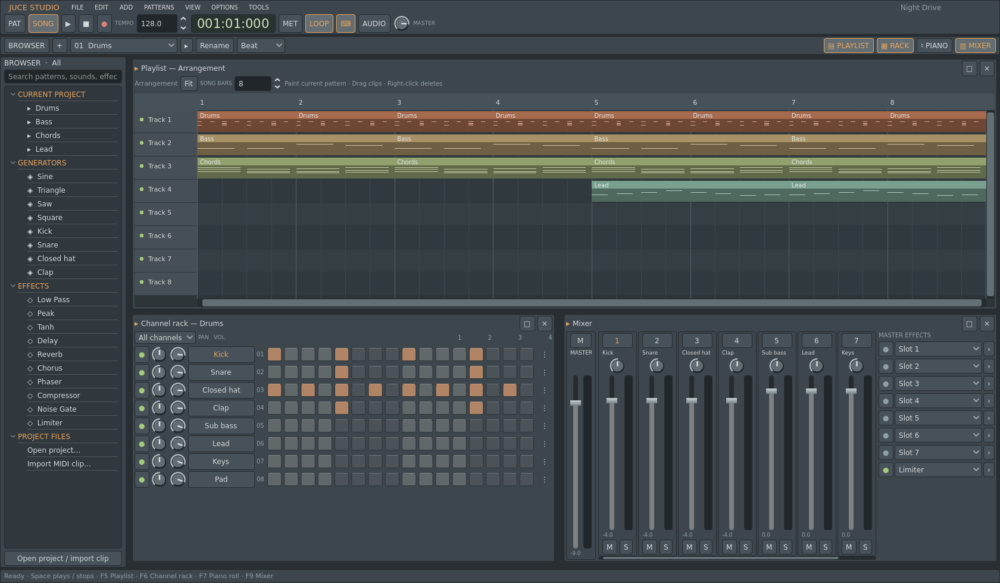
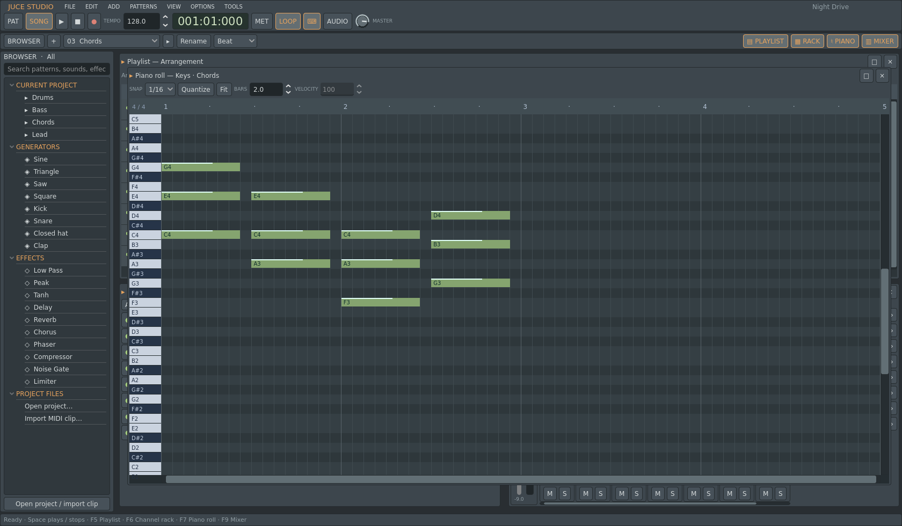

# JUCE Studio workspace

A modern dark, FL-style workspace built with Godot controls and the JUCE GDScript API. It combines a channel rack, playlist, piano roll, mixer, browser, transport and typing piano. The controls edit real project data and drive native audio.



## Run

Download the Windows package for **API 0.7.0**, extract the download and the ZIP inside it, import `demo/project.godot` in standard Godot 4.7, and press **F5**. The workspace is now the main scene. Close Godot before replacing an older native DLL. A Git clone contains source and scripts, without the compiled DLL.

The included **Night Drive** project has procedural drums, bass, chords and a lead. Press **Play** or **Space** to hear it. Use **Options → Audio settings** to select your output, sample rate and buffer. Audio is opened when you play, monitor or trigger a typing note; it does not start automatically on launch.

The earlier examples remain available: open `main.tscn`, `examples/typing_keyboard.tscn` or `examples/clip_recorder.tscn` and press F6. No editor plugin needs enabling, and the visual DSP graph editor remains removed.

## Main controls

| Control | Behavior |
| --- | --- |
| PAT / SONG | Play the selected pattern or the playlist arrangement. Switching stops the current transport. |
| Play / Space | Start or stop playback. |
| Stop | Stop audio and return to the beginning. |
| Record / Ctrl+R | Record typing/mouse notes into the selected pattern, starting at zero in PAT mode. |
| Tempo | Change BPM from 20–300 while playing; note positions remain in beats. |
| Clock | Click to switch bar/beat/tick display and elapsed playback time. |
| MET / LOOP | Metronome and playback looping. Timing uses 4/4. |
| Keyboard button / Ctrl+T | Enable or disable musical typing. |
| Master knob | Master level from -60 to 0 dB. |
| Pattern selector / + / F4 | Select, create, duplicate and rename patterns. |
| View buttons | Show/hide the playlist, rack, piano roll and mixer. |

F5 toggles the playlist, F6 the channel rack, F7 the piano roll, F8 the browser and F9 the mixer **while the game window has keyboard focus**. Space is transport in this workspace; the standalone typing-piano example keeps its original Space-for-sustain behavior. Sustain in this workspace is available in the typing-piano window. Esc releases notes. Ctrl+S/O/N save/open/new, and Ctrl+Z / Ctrl+Shift+Z undo/redo. Text fields keep normal typing and local editing.

## Channel rack and instruments

The default eight channels are Kick, Snare, Closed hat, Clap, Sub bass, Lead, Keys and Pad. The four drums are generated by the native instrument; no external sample pack is required. The project supports up to sixteen MIDI/instrument channels, sharing the native 32-voice pool.

- Click a step to add/remove a note at that sixteenth-note position. The sixteen steps show the pattern's first bar.
- Click a channel name to select it; double-click it to open its piano roll. The row menu also opens the piano roll or instrument settings, fills steps, or clears the first bar.
- The green LED mutes/enables the channel. The two knobs control pan and volume. Drag vertically, hold Shift for finer control, or double-click to reset.
- All channels, drums and instruments can be filtered with the rack's group selector.
- **Add** creates another generator channel. **Options → Instrument settings** changes its name, generator and default step-note pitch.

Click a channel to route typing notes to it. Drums start the typing layout at MIDI 36, while synth channels start at MIDI 60; octave buttons/brackets transpose it. Z–M and Q–U use the existing physical-QWERTY piano mapping. Typing works even with the on-screen piano window closed. Opening it through View provides mouse keys, octave controls and a sustain button.

## Playlist and patterns

Choose a pattern, then click empty playlist space to paint an instance. Drag a clip body to move it between time and lanes; drag its right edge to resize it. An instance longer than its pattern repeats the pattern; a shorter one crops it. Right-click or Delete removes a selected clip. Double-click opens its pattern in the piano roll. Patterns can also be dragged from the browser into the playlist.

The snap selector controls playlist placement. Wheel scrolls lanes, Shift+wheel scrolls time, Ctrl+wheel zooms time, and Fit fits the song. Click a lane header to mute that lane. Song Bars changes the region length; shortening is rejected if clips extend beyond it. Arrangement edits stop audio before rebuilding its playback snapshot.

There are eight arrangement lanes, up to 64 patterns, 128 placed clips and 256 song beats. Playback compiles the arrangement into the native scheduler's limit of 4096 notes. Multiple clips can overlap; their notes are mixed. Lane mute controls arrangement playback, while mixer mute controls that instrument in both PAT and SONG modes.

## Piano roll and recording



The piano roll edits the selected pattern **and selected channel**. Other channels' notes remain in the pattern. Click to draw, drag to move, drag the right edge to resize, and right-click/Delete to remove. The toolbar controls note snap, quantization, pattern bars and selected-note velocity. Wheel scrolls pitches, Shift+wheel scrolls time and Ctrl+wheel zooms time.

At least four bars are available for editing. Drawing beyond the current pattern length extends it to the next bar. Existing playlist instance lengths stay explicit; resize those instances if you want to include an extension. Quantize affects the selected channel. All notes are stored in beats.

Press Record, play the typing/mouse piano, then Stop. Released notes appear in the piano roll; held notes are finalized on Stop. A take is one undo step. Selecting another pattern is blocked during recording, but you can select another channel to record more instruments into the same pattern. The live playback snapshot stays fixed during a take and updates after Stop → Play.

Live input still has Godot frame and audio-buffer latency. Stored notes are scheduled natively at sample positions. Recordings store notes/velocity/channels; sustain CC and tempo automation are not saved. The project has one BPM value.

## Mixer and master effects

Mixer faders, pan, mute and solo affect native audio. The per-channel meters show native levels; Master shows the post-effects output. Volume, balance and mute/solo gain changes use 5 ms ramps. Faders are -60 to +6 dB per channel, with master limited to 0 dB. The mixer scrolls horizontally when all strips do not fit.

The right-hand **Master Effects** slots process the master bus. Choose a supported effect, click its green power button to bypass it, or click › for parameter controls. Knobs update live numeric parameters. Changing an effect type stops playback to rebuild the native chain. The default last slot is a limiter; you can replace or remove it.

Slots support low-pass, peak EQ, saturation, delay, reverb, chorus, phaser, compressor, noise gate and limiter. These are native JUCE/DSP processors from the API. The current slots are on Master; per-insert effects, sends and routing matrices are not part of this version. The generators are built-in procedural instruments, without external VST hosting.

## Browser, projects and layout

Search filters the browser. Click a project pattern to select it or drag it into the playlist. Double-click a generator to load it into the selected channel, or an effect to add it to the next free master slot. Project file entries open the file dialogs.

File Save/Save as writes `.daw.json`: patterns, arrangement, channel names/settings, master level and effects. Open validates the complete document before replacing the current project. New/Open/close prompt before discarding dirty work. Save before forcibly stopping the game in Godot's editor. Import MIDI clip accepts the existing `.midiclip.json` format and keeps its MIDI channel numbers; choose appropriate generators for those channels. Export MIDI exports the current PAT or SONG mode as a standard `.mid` file with a tempo event.

Drag editor title bars to move them, drag the lower-right corner to resize, double-click titles or click □ to maximize/restore, and click × to close. View buttons reopen them. Options saves/restores workspace layout separately from project data; View → Reset layout restores the default arrangement. JSON project files are limited to 8 MiB.

This workspace is a working first DAW interface with the core pattern workflow. FLP loading, audio-clip editing/recording, arbitrary MIDI-file import, automation clips, external plugin hosting and full FL Studio feature parity are not implemented.

## API and source

`daw_studio.gd` connects reusable controls under `addons/juce_bridge/ui/daw_*`. `daw_project.gd` owns project/history/validation, `daw_playlist.gd` edits arrangement instances, and `daw_pattern_view.gd` adapts one pattern/channel to the shared piano-roll control. `daw_window.gd`, `daw_knob.gd` and `daw_theme.gd` handle the window and control styling.

Native additions in API 0.7:

```gdscript
sequencer.set_channel_settings(1, {
    "volume_db": -6.0, "pan": -0.25, "mute": false, "solo": false, "waveform": 4
})
print(sequencer.get_channel_settings(1))
print(sequencer.get_channel_peaks()) # Sixteen post-channel-gain peak values.

# Stop the device before attaching/replacing the master network.
device.set_sequencer(sequencer)
device.set_post_network(master_fx) # JuceDSPNetwork, or null to clear it.
```

Channel settings accept volume -60…+6 dB, stereo balance -1…+1, boolean mute/solo and waveform -1…7. -1 follows the global synth waveform; 0–3 are sine/triangle/saw/square, and 4–7 are kick/snare/hat/clap. Generator changes affect newly triggered voices. The master graph must be attached to a sequencer source. Its buffers are prepared with the device and execute after the instrument, with native ownership guards and alias-safe audio routing. The callback uses no GDScript. Physical Windows 11 device latency still requires direct hardware testing.
