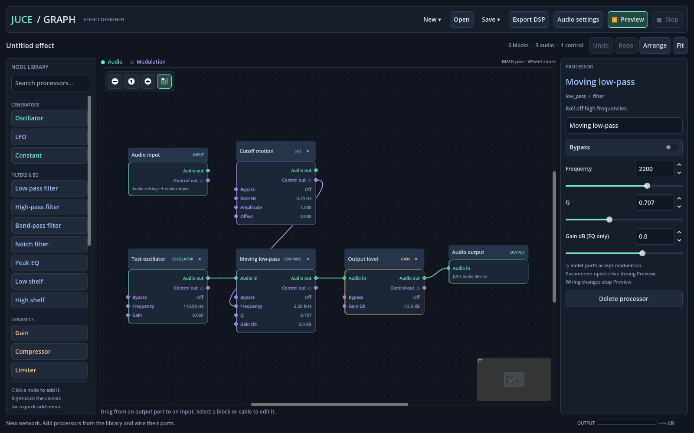

# JUCE visual graph editor

Build native DSP effects by placing blocks and drawing cables. The interface uses Godot's GraphEdit/GraphNode controls and the existing `JuceDSPNetwork` API; no C++ changes are needed to assemble supported processors.



## Open it

In the downloaded Windows package, import **demo/project.godot** and either:

- Run the main scene for the standalone interface.
- Click the **JUCE Graph** tab in Godot's main-screen toolbar. The plugin is enabled in the demo. In another project, copy `addons/juce_bridge`, reopen the editor, and enable **JUCE DSP Graph** under **Project → Project Settings → Plugins**.

The previous slider demo remains at `demo/slider_demo.tscn`. The visual editor requires a compiled native addon with API 0.3 or later; this package carries version 0.4.

## Make an effect

1. Start with **New → Modulated filter**, **Live input effect**, or **Blank network**.
2. Search the Node Library and click a processor to place it. Right-click the canvas for a quick-add menu.
3. Drag a **teal Audio out** port to a **teal Audio in** port. Multiple inputs are summed, except Multiply nodes, which multiply incoming signals.
4. Select a block to edit parameters in the inspector. Sliders and numeric fields update the native engine; parameters can change while Preview runs. Give a block a title in the inspector without changing its stable DSP ID.
5. Drag **violet Control out** to a violet parameter port for modulation. Select that cable to set depth, offset and source channel, then click **Apply connection settings**.
6. Open **Audio settings**, choose an output device, and click **Preview**. A source-only network needs an Oscillator or other generator connected to Output. Live effects require **Enable live audio input**. Use headphones when monitoring a microphone.

The starter graph contains a quiet triangle oscillator, a low-pass filter, an output gain block and an LFO controlling cutoff. Audio input is deliberately disabled until you enable it. Selecting a live-input starter does not silently activate microphone capture.

Input and Output are permanent nodes. An unconnected Output is silent. Cycles, duplicate connections, invalid parameter targets and invalid ranges are rejected by the native API. Rejected operations leave the old network in place.

### Connections and controls

- **Audio cable:** select it to edit its signed gain or remove it.
- **Modulation cable:** select it to edit depth, offset and left/right source channel. Effective control values follow `base + source × depth + offset`, clamped to the parameter range.
- Modulation uses the first source sample once per audio block. This is control-rate modulation, not sample-accurate parameter automation.
- **Waveform** is a discrete inspector control and has no modulation port. Low/high-pass, band-pass and notch filters retain the legacy gain parameter in the API; the inspector marks it **EQ only**, as it is unused for those filter types.
- Editing wiring, adding/removing processors, loading a patch and undo/redo stop Preview. Press Preview again after editing. Moving blocks does not change audio topology.
- Right-click a connected port to disconnect it. The cable inspector also provides **Remove connection**.

The engine executes native JUCE DSP. GDScript controls topology and parameters; it is not called for each audio sample. See [DSP network details](DSP_NETWORKS.md) for processor ranges and limitations.

## Navigate and edit

| Action | Control |
| --- | --- |
| Pan canvas | Middle mouse drag |
| Zoom | Mouse wheel or canvas zoom buttons |
| Fit the network | Fit |
| Arrange by dependencies | Arrange |
| Select a block or cable | Left click |
| Delete selected processors | Delete, or Delete processor in the inspector |
| Undo | Ctrl+Z |
| Redo | Ctrl+Shift+Z or Ctrl+Y |
| Save | Ctrl+S |
| Save as | Save menu or Ctrl+Shift+S |
| Open | Ctrl+O |

Undo/redo includes node creation/deletion, wiring, cable settings, parameters, titles and positions. Slider gestures are grouped after a short pause. History retains up to 100 states. The interface targets desktop windows of at least 1080×720; the side panels scroll when needed.

## Save and reuse

**Save** writes a `.jucegraph` document containing the native DSP patch, block positions/titles and canvas view. Existing graph files are overwritten only through a save action or the file dialog's overwrite confirmation. New/Open/standalone close ask before discarding unsaved work.

**Open** accepts both `.jucegraph` documents and native DSP `.json` patches. Imported DSP-only patches get default positions and start as an unsaved graph; saving them does not overwrite the original DSP JSON.

**Export DSP** writes the original strict native JSON schema, without editor metadata. Use it in your DAW:

```gdscript
var effect := JuceDSPNetwork.new()
if not effect.load_patch_file("user://my_effect.json"):
    push_error(effect.get_last_error())
```

File loading validates layout fields and the native graph before replacement. Broken JSON, invalid layout data and invalid DSP graphs do not replace the current effect. Files are limited to 2 MiB. Saved positions and titles are preserved; arbitrary valid DSP IDs are mapped to safe internal Godot node names.

The editor periodically preserves unsaved work in a recovery file in the project's `user://` directory. The plugin and standalone app use separate recovery files. Recovery never starts audio automatically. A successful named save clears recovery; closing the standalone app with **Discard changes** does not recreate it. Disabling the editor plugin preserves dirty work for its next activation.

## Embed the interface in your own Godot UI

Instance this scene under a Control in your project:

`res://addons/juce_bridge/editor/graph_editor.tscn`

```gdscript
const GraphEditor = preload("res://addons/juce_bridge/editor/graph_editor.tscn")

func _ready():
    var graph_ui = GraphEditor.instantiate()
    add_child(graph_ui)
    graph_ui.patch_changed.connect(_on_patch_changed)
    # Its own JUCE audio preview is optional; native settings/topology are accessible.

func _on_patch_changed(patch: Dictionary):
    # Store or validate the exported DSP patch for your application.
    pass
```

Public UI methods include `add_processor(type, position)`, `inspect_node(id)`, `open_file(path)`, `new_network(preset)`, `start_preview()`, `stop_preview()`, `fit_graph()` and `get_network()`. The document model at `editor/graph_document.gd` provides UI-independent editing, history and serialization.

`patch_changed(patch)` reports edits. `topology_edit_requested` is emitted before structural edits; if your application owns a running device manager using `get_network()`, connect this signal to stop that manager before editing. Otherwise, consume exported patches with your own independent network. Only one running manager can own a network.

The reusable scene does not take over window-close handling or enable recovery by default. The demo opts into both. Hiding the editor-plugin tab stops its preview. Audio-device names/settings are local session choices and are not baked into DSP patches.

## Validation

Automated checks exercise native port mapping, audio/control routing, cycle rejection, parameter controls, deletion, undo/redo, positions/titles, Unicode DSP IDs, transactional document loads and file overwrite behavior. Input-driven checks draw a cable with mouse events, pick the cable, change its gain, delete/undo a processor, search/add a palette node and move a parameter slider. The real UI is also rendered and inspected on a Linux software-OpenGL display.

Windows CI runs the editor and interaction checks with both Godot 4.5.1 and Godot 4.7 before packaging the DLL and UI. Linux checks also pass on both versions, including the actual rendered interface on Godot 4.7. Physical audio devices, Windows 11-specific display behavior and touchscreen input still need direct testing. This is a DSP-network editor, not a compiler for arbitrary GDScript/C++ sample callbacks; it exposes the supported processor and modulation nodes.
