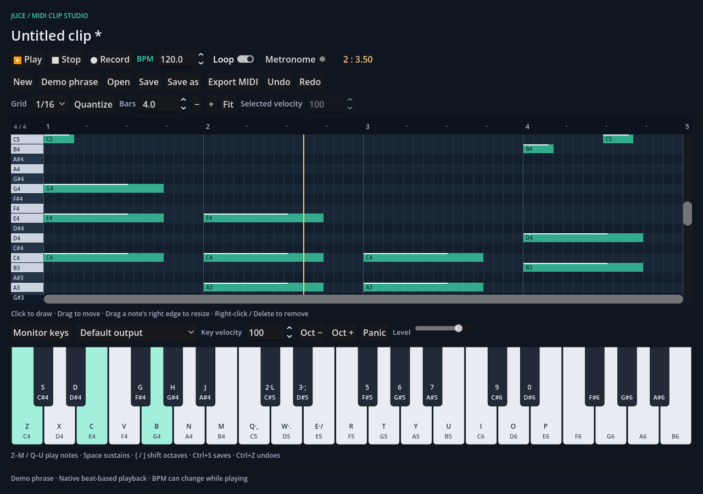

# MIDI recording, piano roll and BPM

The clip studio is a Godot example backed by `JuceMidiSequencer`. Native code schedules stored notes on the audio sample timeline and provides a 32-voice audition instrument. Godot edits the clip and displays the transport.



## Open it

Use the compiled Windows package for API **0.6.0** or later. A Git clone does not contain the DLL. Close Godot before replacing an older addon, then import `demo/project.godot` in Godot 4.7.

Open `res://examples/clip_recorder.tscn` and press **F6**. The example opens at 1280 × 900. F5 opens the new DAW workspace; the original slider demo remains in `main.tscn`. The visual DSP graph editor remains removed.

## Playback and BPM

Click **Demo phrase**, select your output device, then click **Play**. Change **BPM** while playing: the range is **20–300**, including fractional values. Notes stay in the same positions and keep their pitch; changing tempo changes how quickly playback moves through them. Native tempo updates take effect at callback boundaries.

**Loop** repeats the clip. **Metronome** ticks on quarter notes and accents every four beats. **Stop** stops audio and returns to the beginning. Play starts from zero. The ruler uses 4/4; **Bars** changes length in quarter-bar increments. Shortening is rejected if it would cut off existing notes.

## Record

1. Set BPM and optionally enable the metronome.
2. Click **Record**. There is no count-in in this version.
3. Play the typing keys or click the piano. Z starts at C4; Q at C5. See the [keyboard guide](MIDI_KEYBOARD.md) for the full mapping.
4. Release notes to see them appear in the roll. Stop also finalizes notes still held.
5. Click **Stop**, then **Play** to hear the take.

Recording adds notes to the existing document. Use **New** for an empty take. The scheduled playback snapshot stays fixed during recording: new notes are heard live, then join clip playback after Stop → Play. Loop recording wraps into the same clip. A note crossing its edge is split into two; a hold longer than the region is limited to one loop. Each take is one undo step, including BPM changes made during that take.

The clip stores note starts, lengths, velocity and MIDI channel. Sustain is heard live but is not recorded as CC data; note lengths use physical release. The saved clip has one BPM value, without tempo automation. Live input retains Godot frame and buffer latency and is consumed at the next audio callback. Stored note playback uses native sample timing independently of redraws.

## Edit

| Action | Control |
| --- | --- |
| Draw | Left-click empty space; drag right for length. |
| Move | Drag a note's body. |
| Resize | Drag its right edge. |
| Delete | Right-click a note, or select it and press Delete. |
| Velocity | Select a note, then use Selected velocity (1–127). |
| Quantize | Choose a grid, then Quantize to snap all starts and ends. |
| Scroll pitches | Wheel, vertical scrollbar or middle-drag. |
| Scroll time | Shift+wheel, horizontal scrollbar or middle-drag. |
| Zoom time | Ctrl+wheel or − / +. Fit fits the clip horizontally. |
| Undo / redo | Ctrl+Z / Ctrl+Shift+Z or Ctrl+Y. |

Grid choices are 1/4 through 1/64 notes: 1/16 equals 0.25 beats. Recording preserves measured beat times until you quantize. Edits stop audio; mouse editing is disabled during a take. Pitch scrolling covers MIDI 0–127, and selection is one note at a time.

**Monitor keys** auditions without advancing/recording the clip. **Key velocity** affects new played notes, and **Selected velocity** edits a clip note. **Level** sets the native instrument volume. JUCE output is separate from Godot audio buses.

## Save

Save/Save as writes `.midiclip.json` with BPM, clip length and notes. Open accepts this format and rejects invalid files without replacing the current document. New/Open/window close ask before discarding unsaved changes. The title's asterisk indicates unsaved work. Save stops and commits a running take before writing. Save before forcibly stopping the game from Godot's editor.

Export MIDI creates a standard `.mid` file with 960 ticks per quarter note, 7-bit velocities and the current BPM as a tempo event. Importing arbitrary `.mid` files into the roll is not included yet. File dialogs confirm overwrites; document save/export methods require `overwrite=true` to replace files. Limits are 2 MiB JSON, 4096 notes and 1–256 beats.

## GDScript API

```gdscript
extends Node

var sequencer := JuceMidiSequencer.new()
var device := JuceAudioDeviceManager.new()

func _ready() -> void:
    var notes := [
        {"note": 60, "start": 0.0, "length": 1.0, "velocity": 0.8},
        {"note": 64, "start": 1.0, "length": 1.0, "velocity": 0.8},
        {"note": 67, "start": 2.0, "length": 2.0, "velocity": 0.8},
    ]
    if not sequencer.load_clip(notes, 4.0):
        push_error(sequencer.get_last_error())
        return
    sequencer.set_bpm(120.0)
    sequencer.set_looping(true)
    device.set_sequencer(sequencer)
    if not device.start_audio():
        push_error(device.get_last_error())
        return
    sequencer.play() # Start the device (or prepare offline) before Play.

func change_bpm(value: float) -> void:
    if not sequencer.set_bpm(value):
        push_error(sequencer.get_last_error())

func _exit_tree() -> void:
    device.stop_audio()
```

Connect the piano's `midi_message` to `sequencer.queue_midi` for live notes. To record, start audio, call `set_recording(true)` and `play()`, then poll `read_recorded_notes()`. Each result has `note`, `channel`, `start`, `length`, `velocity`. Start is an unwrapped absolute beat; the document wraps/splits it into the loop. Detaching audio finalizes held recordings, so drain again after `device.stop_audio()`.

`get_transport()` reports BPM, clip beat, elapsed beats, flags, elapsed playback samples, audio ownership and queue-drop counters. These are atomic observations for display, not a synchronized timestamp snapshot. `stop()` requests a reset on the next callback, keeping the device open for monitoring. `device.stop_audio()` detaches callbacks and closes it. Stop the device before clip replacement, preparation or offline processing. A manager uses either `set_network()` or `set_sequencer()`; switching requires stopping.

For offline output, load the clip, `prepare(rate, channels)`, `play()`, then `process(buffer)`. Additional zero-source processing renders release tails. Waveform 0–3 selects sine/triangle/saw/square, and `set_volume_db()` accepts -60–0 dB. Waveforms are simple, without band-limiting. The built-in instrument does not yet accept a custom DSP effect chain or host plugins.

## Reuse the controls

- `addons/juce_bridge/ui/midi_clip.gd`: document, validation, undo, quantization, JSON and MIDI export.
- `addons/juce_bridge/ui/piano_roll.gd`: grid, note editing, selection, scroll and playhead. Add it to the tree, then call `set_document(model)`. Connect `edit_requested` to stop audio before edits, `selection_changed(id)` to an inspector, and update `set_playhead(native_beat)` for display.
- `addons/juce_bridge/ui/midi_keyboard.gd`: the existing typing/mouse controller.

`examples/clip_recorder.gd` wires these together without an editor plugin. The audio core uses fixed voices and bounded queues: 1023 pending inputs and 4096 completed recorded notes. Input overflow schedules panic to avoid stranded note-offs; drop counters warn if data was lost. Call the API on the main thread; the audio callback never calls GDScript. This version is one clip and one instrument, without multi-track mixing, tempo automation, MIDI CC recording, or sample-accurate external input timestamps.
