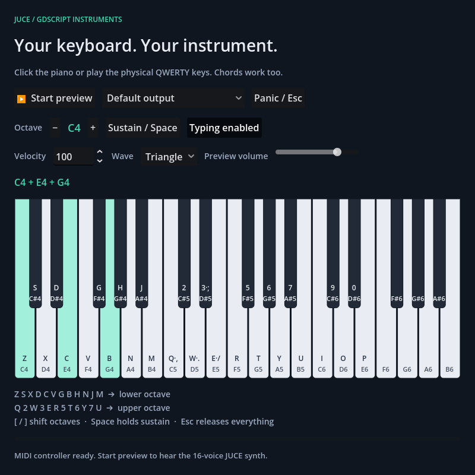

# On-screen piano and typing keyboard

This example uses Godot for the piano interface and typing input. The reusable controller emits `JuceMidiMessage` values. A separate, optional JUCE instrument turns those messages into sound using the existing GDScript API.



## Run it on Windows

1. Download the compiled Windows package from the successful build linked in the keyboard pull request. Extract the artifact and the ZIP inside it. A Git clone contains scripts/source but does not contain `juce_bridge.dll`; use the compiled package's addon if you are working from a clone.
2. Import `demo/project.godot` in Godot 4.7.
3. Open `res://examples/typing_keyboard.tscn` and press **F6** (Run Current Scene). The project's F5 main scene remains the original API slider demo.
4. Choose your output device and click **Start preview**. Click the piano, or play the mapped typing keys. No microphone input is opened.

The controller does not need an editor plugin. The JUCE Graph visual DSP editor remains removed.

## Play with your typing keyboard

The default uses the physical US-QWERTY positions of a familiar two-row piano layout. Default base is MIDI note 60, named C4 here. Some DAWs use a different octave label for the same MIDI number.

| Note | Lower row | Upper row (one octave higher) |
| --- | --- | --- |
| C | Z | Q |
| C# | S | 2 |
| D | X | W |
| D# | D | 3 |
| E | C | E |
| F | V | R |
| F# | G | 5 |
| G | B | T |
| G# | H | 6 |
| A | N | Y |
| A# | J | 7 |
| B | M | U |

The upper row continues with **I / 9 / O / 0 / P** for C6 through E6. The lower row also continues with **comma / L / period / semicolon / slash**, overlapping Q through E. If you hold two keys assigned to the same note, it stays on until you release both.

- **[ / ]** or the octave buttons shift the starting octave. Existing notes are released before transposing.
- **Space** holds sustain; release Space to lift it. The Sustain button can also latch the pedal.
- **Esc / Panic** releases all notes and resets sustain.
- **Velocity** controls note strength from 1–127. Typing keyboards do not measure how hard you press.
- **Typing enabled** lets you disable musical typing while keeping mouse input available.
- Hold several mapped keys for chords. The number of simultaneous keys your computer reports depends on its keyboard hardware.
- Click and drag across the piano to play a glissando. Black keys take priority where they overlap white keys. Releasing the mouse outside the piano still releases its note.

Ctrl/Alt/Meta shortcuts are left for the host application, key-repeat events are ignored, and typing in a LineEdit/TextEdit/SpinBox does not play notes. Key release is still processed if focus moves while a note is held. Hiding/removing the controller or losing application focus releases all notes.

## Reuse the piano in your own DAW UI

Copy the compiled `addons/juce_bridge` folder into your project, then preload the controller from a script on a Control:

```gdscript
extends Control

const Piano = preload("res://addons/juce_bridge/ui/midi_keyboard.gd")
var piano: Control

func _ready() -> void:
    piano = Piano.new()
    add_child(piano)
    piano.set_anchors_and_offsets_preset(Control.PRESET_FULL_RECT)
    piano.midi_message.connect(_on_midi_message)

func _on_midi_message(message: JuceMidiMessage) -> void:
    if message.is_note_on():
        print("Note on: ", message.get_note_number(), " velocity: ", message.get_velocity())
    elif message.is_note_off():
        print("Note off: ", message.get_note_number())
    elif message.is_controller():
        print("CC: ", message.get_controller_number(), " value: ", message.get_controller_value())
```

This logs MIDI messages; it does not automatically produce sound. Give the piano at least **630 × 220** pixels. Use one typing-enabled piano per viewport, so multiple instances do not compete for the same keys. Disable `typing_enabled` when another part of your application needs those keys. Custom controls which consume key events keep priority because note-on uses Godot's unhandled-key input stage.

The controller's main settings and signals are:

| Setting / signal | Meaning |
| --- | --- |
| `base_note` | First visible C; multiples of 12, from 0 to 84. Default 60. Changing it releases notes. |
| `velocity` | Typing/mouse velocity, 1–127. The note-on signal and JUCE message use normalized 0–1 values. |
| `midi_channel` | Channel 1–16. Changing it releases notes on the old channel first. |
| `typing_enabled` | Enable/disable computer-key input. Disabling releases notes. |
| `midi_message(message)` | JUCE note-on, note-off, sustain CC64 and panic CC123 messages. |
| `note_on(note, velocity)` / `note_off(note)` | Simpler Godot signals for your own sound engine. |
| `octave_changed(octave)` / `sustain_changed(enabled)` | Keep your own labels/buttons in sync. |

## Connect it to an instrument

MIDI is a set of instructions: note number, strength, note-on/off and controller values. It does not contain the sound itself. Your instrument must interpret those instructions.

For the included preview, copy `examples/keyboard_synth.gd` too, create a synth member and connect the signal:

```gdscript
const PreviewSynth = preload("res://examples/keyboard_synth.gd")
var synth := PreviewSynth.new()

# In _ready(), after constructing the piano:
# if synth.start():
#     piano.midi_message.connect(synth.handle_midi)
# else:
#     push_error(synth.last_error)

func _exit_tree() -> void:
    synth.stop()
```

The complete wiring, output selection and error handling are in [typing_keyboard.gd](../demo/examples/typing_keyboard.gd). To use your own instrument, connect its MIDI handler instead. Do not connect both `note_on` and `midi_message` to the same instrument's note trigger, or it will receive duplicate notes.

The preview builds 16 pairs of oscillator and ADSR nodes in one `JuceDSPNetwork`. Each active note gets a separate voice, so a new note does not change a held note's pitch. All envelopes feed a master gain and a limiter before output. Its waveform and volume controls affect the preview only.

This is a small audition synth: if all voices are held, sustained, or finishing their short release, new preview notes are skipped with a status message. The controller still emits every MIDI event. Released voices are briefly held out of the pool so a block-rate gate-off can complete before reuse. GDScript MIDI handling has frame latency, and the DSP gate/parameter updates are block-rate; this is not sample-accurate event scheduling. JUCE owns the audio device independently of Godot's audio buses. External MIDI device output is not bound by this addon.

## Change or add key assignments

The default leaves some typing keys available for other controls. You can map any additional physical letter, number or function key to a note offset, within the displayed three-octave range:

```gdscript
var mapping := piano.get_key_mapping()
mapping[KEY_A] = 0  # A also plays the base C.
mapping[KEY_F] = 5  # F also plays the base F.
mapping[KEY_K] = 11 # K also plays the base B.
if not piano.set_key_mapping(mapping):
    push_error("Invalid keyboard mapping")
```

Offsets must be integers from 0–35. Space, Esc and the two bracket keys are reserved. You can also replace the dictionary completely. Replacing a mapping releases held notes, and the drawn shortcut labels update automatically. Black and white notes are simply MIDI notes one semitone apart; you are free to choose a different musical layout.

For scripted/touch controls, use `press_note(note, normalized_velocity, source_token)` and `release_source(source_token)`. Give every independent held control its own token (for example `"touch:0"` and `"touch:1"`). `get_active_notes()` returns physically held notes; sustain is represented separately. `set_sustain(bool)` and `all_notes_off()` provide the pedal and panic actions.
